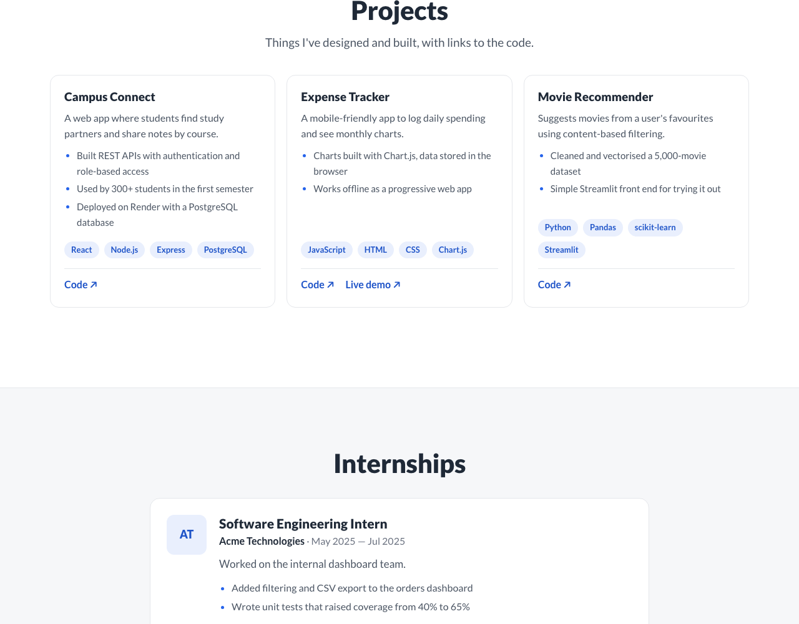
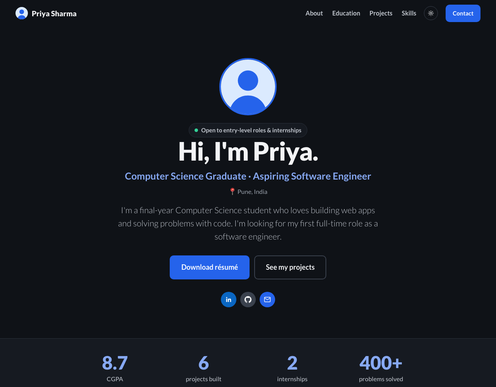
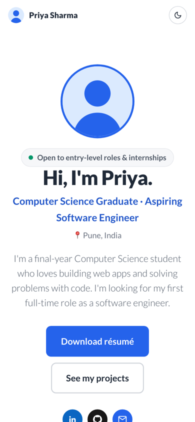
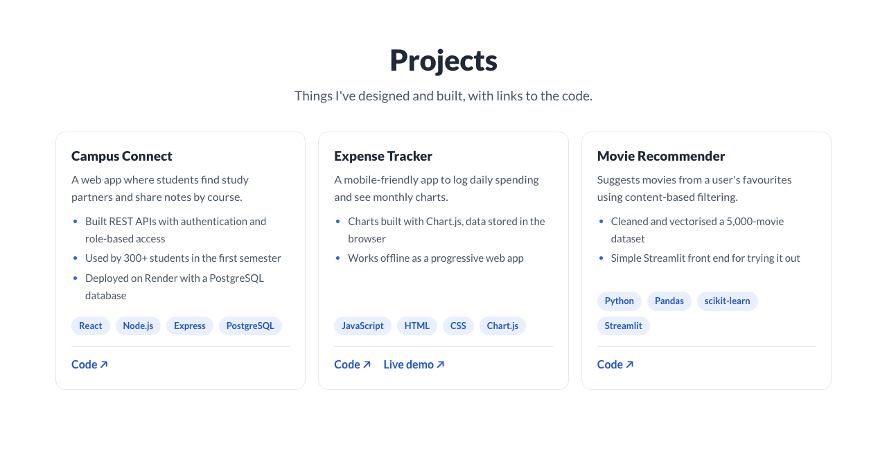
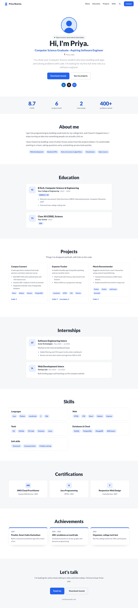

# Portfolio Starter for Freshers

A clean, one-page portfolio website for students and freshers. Clone it, fill in your details, add your résumé, and you have a site to put on your résumé, your LinkedIn and your job applications. Setup takes about 15 minutes, and hosting is free.

You don't need to know HTML. All of your content goes in **one file**, `src/_data/profile.json`.

**What's on the page**

Hero with your photo and a résumé button → quick stats (CGPA, projects…) → About → Education → **Projects** (with GitHub and live demo links) → Internships → Skills → Certifications → Achievements → Contact.

- A blue theme (or any colour you choose), with light and dark mode
- Looks good on phones
- Any section you leave empty is hidden automatically
- Basic SEO built in: share previews, `sitemap.xml`, `robots.txt` and a 404 page

## Preview

This is what you get out of the box, filled with sample data you'll replace with your own.



<table>
  <tr>
    <td width="50%"><br /><sub><b>Dark mode</b>, which follows the visitor's system setting and has a toggle</sub></td>
    <td width="50%" align="center"><br /><sub><b>On a phone</b>, the layout adapts to small screens</sub></td>
  </tr>
</table>


<sub><b>Projects</b>, the section recruiters look at most. Each card links to the code and a live demo.</sub>

<details>
<summary><b>See the whole page</b></summary>
<br />

</details>

---

## Step 1: Get it running on your computer

Install [Node.js](https://nodejs.org/) (version 18 or newer), then run:

```bash
git clone <this-repo-url> my-portfolio
```

```bash
cd my-portfolio
```

```bash
npm install
```

```bash
npm start
```

Open <http://localhost:8080> in your browser. The page updates every time you save a file.

## Step 2: Add your details

### Quick start: the setup wizard

```bash
npm run setup
```

The wizard asks for your name, headline, location, a short intro, email, site URL, and LinkedIn, GitHub and LeetCode links. Press Enter to keep a value, or type `-` to remove it.

### Then fill in `src/_data/profile.json`

Open it in any editor (VS Code works well) and replace the sample details with yours:

| Section | What to put there |
| --- | --- |
| `stats` | 3–4 quick numbers: CGPA, projects built, internships, problems solved |
| `about` | 1–2 short paragraphs about you |
| `interests` | Areas you want to work in (shown as tags) |
| `education` | Degree, college, years, CGPA or %, and optional coursework |
| `projects` | **The most important section.** What it does, what you did, the tech used, and GitHub/demo links |
| `internships` | Role, company, dates and what you worked on |
| `skills` | Grouped lists, e.g. Languages, Web, Tools |
| `certifications` | Name, issuer, year and a link to the certificate |
| `achievements` | Hackathons, coding contests, awards, clubs |
| `contact` | Your email and résumé path |

**No internships yet?** Set `"internships": []` and that section disappears. The same works for every other list.

**Tips for the projects section**

- Put your best project first.
- Write results, not just tasks: "Used by 300+ students" beats "Made a website".
- Add a screenshot: put an image in `src/images/projects/` and set `"image": "/images/projects/campus-connect.png"`.
- Make sure every GitHub repo you link has a README.

### Your photo

Put a square photo (400×400 or larger) at `src/images/profile/me.jpg` and set `"photo": "/images/profile/me.jpg"`. To show no photo, set it to `""`.

### Your résumé

Export your résumé as a PDF and save it as `src/files/resume.pdf`, replacing the placeholder. Both "Download résumé" buttons link to it. To hide the buttons, set `"resume": ""`.

### Links and colours (`src/_data/site.json`)

- **`social`**: fill in the `url` of each icon you want and leave the rest empty. The available icons are `linkedin`, `github`, `code` (LeetCode/HackerRank/CodeChef), `x`, `medium`, `youtube`, `email` (use `mailto:you@example.com`) and `website`.
- **`accentColor`**: blue (`#2563EB`) by default. Other good options are `#0D9488` (teal), `#7C3AED` (purple) and `#DC2626` (red). For a light colour such as yellow, also set `"accentTextColor": "#111827"` so button text stays readable.
- **`nav`**: the links in the top bar.
- **`url`**: your final website address (see step 3).

**Logos (optional):** you can give any college, company or certification a logo with `"logo": "/images/logos/name.png"`. Put the file in `src/images/logos/`. Without a logo, the item's initials are shown instead.

## Step 3: Put it online for free with Netlify

You'll end up with a live address like `https://priya-sharma.netlify.app` that updates every time you push to GitHub. It costs nothing, and you don't need a credit card.

### 3a. Put your code on GitHub

1. Create a free account at [github.com](https://github.com) if you don't have one.
2. Go to [github.com/new](https://github.com/new) and name the repository (for example `portfolio`). Set it to **Public** and leave every "Add a README / .gitignore / license" box **unticked**. Click **Create repository**.
3. In a terminal, inside your project folder, run these (replace `<your-username>`):

```bash
git init -b main
```

```bash
git add .
```

```bash
git commit -m "My portfolio"
```

```bash
git remote add origin https://github.com/<your-username>/portfolio.git
```

```bash
git push -u origin main
```

> When `git push` asks for a password, paste a **personal access token**, not your GitHub password. Create one at GitHub → Settings → Developer settings → Personal access tokens → *Tokens (classic)* → Generate, and tick the `repo` scope.

### 3b. Connect the repository to Netlify

1. Go to [app.netlify.com](https://app.netlify.com) and click **Sign up → Sign up with GitHub**.
2. On your dashboard, click **Add new site → Import an existing project**.
3. Choose **GitHub** and allow Netlify to access your account. You can give it access to just this one repository.
4. Pick your `portfolio` repository.
5. Netlify fills in the build settings from `netlify.toml`. Check that they read:

   | Setting | Value |
   | --- | --- |
   | Branch to deploy | `main` |
   | Build command | `npm run build` |
   | Publish directory | `_site` |

6. Click **Deploy**. After about a minute the status changes to **Published** and you get a link like `https://random-name-123.netlify.app`. Open it: that's your site, live.

### 3c. Give it a proper name

1. In Netlify, open **Site configuration → Change site name** and enter something like `priya-sharma`. Your address becomes `https://priya-sharma.netlify.app`.
2. Put that address in `url` in `src/_data/site.json`, then commit and push:

```bash
git commit -am "Set site URL"
```

```bash
git push
```

From now on, **every `git push` redeploys your site automatically**. Netlify's **Deploys** tab shows each build and its logs.

### 3d. (Optional) Use your own domain

Buy a domain (for example `priyasharma.dev`) from any registrar, then go to Netlify → **Domain management → Add a domain** and follow the steps. Netlify sets up HTTPS for you for free.

### If the deploy fails

- **"Build failed" in the Deploys tab:** open the log and scroll to the first red line. It's usually a typo in `profile.json`, such as a missing comma or quote. Paste the file into [jsonlint.com](https://jsonlint.com) to find it.
- **The page loads but looks unstyled:** make sure the publish directory is `_site`, not `src`.
- **Old content still showing:** hard-refresh with Ctrl+Shift+R (Cmd+Shift+R on Mac).

**Prefer another host?** On Vercel, import the repo and set the output directory to `_site`. On GitHub Pages, use a GitHub Actions workflow that runs `npm ci && npm run build` and publishes `_site/`.

## Before you share it

- [ ] Every "Priya Sharma" / sample value is replaced (search the `src` folder for "your-handle" and "example.com")
- [ ] The résumé PDF is yours and opens correctly
- [ ] All GitHub and demo links work
- [ ] You checked the site on your phone
- [ ] `url` in `site.json` is your live address

---

## Project layout

```
src/
├── _data/
│   ├── profile.json    ← YOUR CONTENT (edit this)
│   └── site.json       ← title, colour, nav, social links
├── files/resume.pdf    ← your résumé
├── images/             ← photo, favicon, logos, project screenshots
├── index.njk           ← the page itself (section order lives here)
├── _includes/
│   ├── base.njk        ← <head>, nav, footer
│   ├── page.njk        ← layout for any extra page
│   └── partials/       ← nav, footer, social icons, logo tile
├── assets/css/style.css
├── assets/js/theme.js  ← light/dark toggle
└── 404.njk, sitemap.njk, robots.njk
scripts/setup.js        ← the setup wizard
docs/screenshots/       ← images used in this README (safe to delete)
```

## Going further

- **Reorder sections:** move the `<section>` blocks in `src/index.njk`. For example, put Projects above Education.
- **Add a page:** create `src/certificates.md` with `layout: page.njk` and `title: Certificates` in the front matter, write Markdown below it, and add `/certificates/` to `nav`.
- **Change the font:** swap the Google Fonts link in `base.njk` and update `--font` at the top of `style.css`.
- **Add analytics:** put the snippet in `base.njk` and add its domain to the Content-Security-Policy in `netlify.toml`.

Built with [Eleventy](https://www.11ty.dev/). MIT licensed: use it, change it, and no credit is needed.
